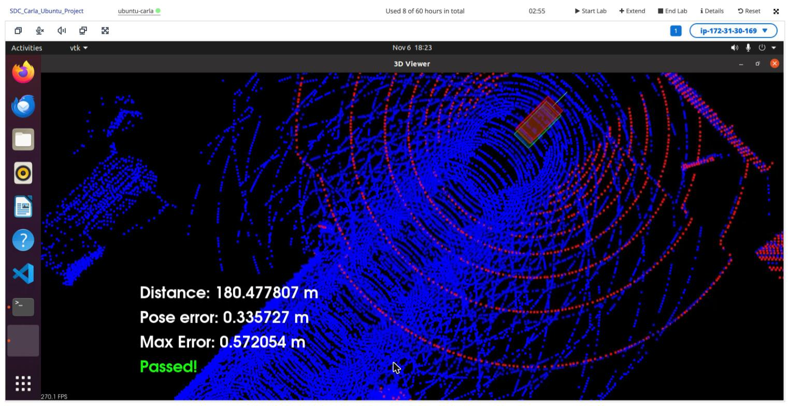

# Scan Matching Localization — Write-up

Localizes a manually driven CARLA car by matching each lidar **Scan** against the prebuilt **Map** (`map.pcd`) with PCL's Normal Distributions Transform (NDT). Terms follow [`GLOSSARY.md`](../../GLOSSARY.md).

## Pipeline (per Scan)

1. **Ingest** each lidar point in the Map's axis convention (`toMapConvention`, see below).
2. **Snapshot** the Scan and its timestamp, then re-arm the listener. The starter loop re-armed first and cleared the buffer last, so the lidar thread could overwrite the cloud mid-processing.
3. **Voxel filter** the Scan (`kScanLeafSize = 0.5 m`).
4. **Initial guess** from a constant-velocity model *in time* (`predictPose`): velocity = last inter-Scan motion (car frame) ÷ its time interval, extrapolated over the actual time to this Scan. Skipped if the implied speed exceeds 25 m/s; horizon capped at 1 s.
5. **NDT match** the filtered Scan to the Map (`NdtLocalizer`) → Pose estimate *at scan time*.
6. **Latency compensation**: advance that estimate to the display frame's timestamp with the same `predictPose`.
7. **Transform** the filtered Scan into the Map frame with the scan-time estimate and render it in red.

The **ground-truth pose** is read once, to seed the first Pose estimate; after that, localization uses lidar only.

## Three problems found on the VM workspace

**1. Lidar axis convention.** The workspace simulator is a different build from the 0.9.9.4 client (hence the "version mismatch" warning). It reports lidar points rotated 90° about z with z inverted relative to the frame `map.pcd` was recorded in. With the raw points, NDT drifted metres while the car was parked, and only ~1% of points landed within 0.3 m of the Map at the true pose. A one-off search over yaw (15° steps) × axis flips × small offsets at the true pose singled out `(x, y, z) → (−y, x, −z)` at zero offset, with 86% inliers. Every point is converted on ingestion.

**2. Scan latency.** Each Scan waits ~60 ms in the buffer (scans arrive every ~105 ms), so the matched pose describes where the car *was*. At medium speed this alone produced ~1.4 m along-track error. Advancing the estimate by our own velocity estimate to the frame time removed the lag.

**3. Irregular scan timing.** When the VM stalls, the gap between Scans jumps from ~0.1 s to 0.6 s. A per-scan motion model then under-predicts by metres; on the long straight road NDT happily converged at the wrong spot along the road and never caught up (lost lock at ~125 m). Making the motion model time-based (velocity × elapsed seconds) fixed it.

| Run (medium speed, 3 throttle taps) | Max pose error |
|---|---|
| Raw lidar frame, parked | 8 m (diverged) |
| Corrected frame, no latency compensation | 1.4 m at ~44 m |
| Corrected frame + latency compensation (per-scan model) | lost lock at ~125 m |
| + time-based motion model (final) | **0.57 m over 180 m — Passed** |

## Files

| File | Role |
|---|---|
| `c3-main.cpp` | Simulator loop; point conversion, the steps above |
| `localization.h/.cpp` | `voxelFilter`, `poseToMatrix`, `predictPose`, `NdtLocalizer` |
| `helper.h` | Added an include guard (it is now included from two files) |
| `CMakeLists.txt` | Adds `localization.cpp` to the build |

## NDT parameters (`NdtConfig`)

| Parameter | Value | Why |
|---|---|---|
| resolution | 1.0 m | Fine enough for road-side structure, coarse enough to be robust |
| step size | 0.1 | Stable line search |
| epsilon | 1e-4 | Stop once the transform barely changes |
| max iterations | 60 | Bounds per-Scan latency; typically converges in 1–5 |

The Map's NDT grid is built once at startup (`setInputTarget`), not per Scan.

## Results

Medium speed (3 throttle taps), lidar-only after the first pose:

- **Distance driven: 180.5 m**
- **Max pose error: 0.57 m** (limit 1.2 m), typically 0.1–0.3 m
- Result: **Passed!**

